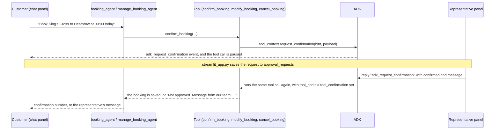

# Taxi Booking Assistant

A taxi booking assistant built with [Google's Agent Development Kit (ADK)](https://google.github.io/adk-docs/) and Gemini. It identifies business and personal customers, measures driving distances with Google Maps, offers a catalog of taxi types, quotes fares, takes bookings, and lets customers look up, change or cancel them. Short-notice requests go to a taxi company representative for approval. Customer and booking data are stored in a local SQLite database.

A Streamlit web UI shows three personas side by side: a customer chatting with the assistant, a taxi company representative approving requests, and a company admin watching operations.

## How it works

Three agents share one conversation and one session state:

| Agent | What it does | Tools |
|---|---|---|
| `booking_concierge` (root) | Greets the caller and works out who they are, then hands over. Business customers give a company reference number, then the passenger's name, email and phone number. Personal customers give their email, or sign up. Callers with no upcoming bookings, such as new customers, go straight to `booking_agent`; the others are asked whether they want a new booking or to manage one, unless they've already said. | `lookup_company_details`, `add_business_customer_details`, `lookup_personal_customer_details`, `add_personal_customer_details` |
| `booking_agent` | Measures the trip with Google Maps, shows the taxi catalog, quotes the fare and confirms new bookings. | `calculate_distance`, `list_taxi_types`, `calculate_total_fare`, `confirm_booking` |
| `manage_booking_agent` | Looks up, changes or cancels the caller's existing bookings. A change can be the pickup time, the taxi type or the number of passengers. | `lookup_booking_details`, `modify_booking`, `cancel_booking`, `list_taxi_types`, `calculate_total_fare` |

**Session state.** As soon as a customer tool finds or registers the caller, it saves their details in session state: `customer_id`, `customer_type`, `company_reference_number`, `company_name`, `customer_name`, `email` and `phone_number`. Before every turn, `booking_agent` and `manage_booking_agent` also save the current date and time as `current_time` (`remember_current_time` in `tools/booking_tools.py`), so the model can turn "tomorrow" or "in two hours" into a real date and time.

ADK gives every agent in the conversation the same session state:

- **The sub-agents' prompts** show the customer's details and the current date and time. Each prompt tells the model to check the details first, and to hand the conversation back to `booking_concierge` if no customer has been identified.
- **The booking tools** take `customer_id` and `customer_type` from session state, so the model never decides who the customer is, what the fare is, or which bookings they can change. As a safety net, they refuse to do anything until a customer is identified.

**Representative approval.** Anything affecting a trip less than 24 hours away needs a representative's approval:

- a new booking whose pickup is less than 24 hours away;
- a change where either the current or the new pickup is less than 24 hours away;
- a cancellation whose pickup is less than 24 hours away.

This uses ADK's own tool confirmation:

1. The tool calls `tool_context.request_confirmation()`, and ADK pauses the tool call.
2. The web UI saves the request to the `approval_requests` table, which is the representative's to-do list.
3. When the representative decides, the web UI records the decision and sends it into the customer's conversation, to the agent that asked. ADK runs the same tool call again.
4. If approved, the booking, change or cancellation goes ahead and the customer gets a confirmation. If rejected, the customer gets the representative's message.

## How the human-in-the-loop works



1. **Pause.** `_approval()` in `tools/booking_tools.py` calls `tool_context.request_confirmation()` the first time a short-notice call runs. ADK records an `adk_request_confirmation` request in the conversation and stops; nothing is saved yet.
2. **Queue.** `send()` in `streamlit_app.py` spots that request in the agent's events and saves it to `approval_requests`, along with the details shown on the representative's card.
3. **Decide.** `decide()` records the representative's choice, then sends it into the customer's conversation as ADK's standard reply: `{"confirmed": true or false, "payload": {"message": ...}}`. Two details matter:
   - The decision is recorded first, and each request can only be decided once. ADK raises an error for a second answer to the same request, which a retry after a failure, or two representatives at once, would otherwise send.
   - The reply goes through the runner of the agent that asked for approval (`get_runners()` makes one for each agent). ADK only resumes a paused tool in the agent that owns it, and by then the customer may be talking to a different agent.
4. **Resume.** ADK runs the original tool call again, with the decision in `tool_context.tool_confirmation`. If it was rejected, `_rejection()` returns the representative's message straight away. If it was approved, the tool repeats its checks, so a pickup that passed while waiting is refused, and then `_approval()` lets it finish.

## How the taxi catalog works

Customers choose a taxi type for each booking: Coupe, Sedan, Executive, SUV or Van. Each type carries up to a set number of passengers and has a price per mile for business customers and another for personal customers. Four layers make this work, each with one job:

| Layer | Its job | Where |
|---|---|---|
| Data | Which taxis exist, how many passengers each carries, and their prices | the `taxi_types` and `rates` tables (`data/schema.sql`, `data/seed.sql`) |
| Tools | **The rules:** the fare uses the taxi's price, and everyone must fit in the taxi | `list_taxi_types`, `calculate_total_fare` and `_taxi_problem()` in `tools/booking_tools.py` |
| Prompts | **The conversation:** ask how many passengers, show the taxis, offer the suggested taxi | `booking_agent` and `manage_booking_agent` |
| Web UI | Show the catalog as cards; **Choose** sends a chat message | `taxi_options()` and `taxi_cards()` in `streamlit_app.py` |

1. **The agent decides when to show the catalog; the web UI decides how.** `booking_agent` calls `list_taxi_types`, and ADK saves the result in the conversation like any tool result. `chat_history()` in `streamlit_app.py` spots that result and draws it as a row of cards with pictures. `adk web` shows the same result as plain data. The tool doesn't return picture file names, so the model can't paste them into a reply as broken image links.
2. **A card is a shortcut for typing.** **Choose** sends "I'd like the SUV." as the customer's message, so the agent handles it like anything else the customer types. Only the newest set of cards can be chosen from.
3. **The passenger limit is a rule in code, not in a prompt.** `confirm_booking` and `modify_booking` check it with `_taxi_problem()`, before anything is saved or sent for approval. If the taxi is too small, nothing changes, and the tool suggests the cheapest taxi that carries everyone, for example "A Coupe carries up to 2 passengers, so it can't take 3. Suggest the Sedan instead". The prompts only tell the agents to offer that suggestion.
4. **A price depends on two things.** The `rates` table has one row for each taxi type and customer type, so its key is both columns. The tools look the price up themselves, so the fare never comes from the chat.

## How distances work

`calculate_distance` in `tools/maps_mcp.py` measures each trip with [Google Maps' MCP server](https://developers.google.com/maps/ai/grounding-lite) ("Maps Experience agent tools"). It also checks that both places are in the UK, with [postcodes.io](https://postcodes.io), a free service built on official ONS and Ordnance Survey data.

1. **Postcodes** are looked up on postcodes.io. They must exist, and be in England, Scotland, Wales or Northern Ireland.
2. **Other places**, such as addresses, stations and airports, are found with Google's `search_places`. Google doesn't say which country a place is in, so postcodes.io must find a UK postcode within 2 km of it.
3. **The distance** comes from Google's `compute_routes`, driving. Google gives metres, and the tool converts them to miles.

The tool is an MCP client. `_google_maps()` opens a session with Google's server over HTTP, sending the key in the `X-Goog-Api-Key` header, and `_call_tool()` calls Google's tools through it. ADK's `McpToolset` could give Google's tools to the agent directly instead. But then the model would get metres and convert them itself, and there'd be nowhere to check the places are in the UK.

If a place isn't in the UK, or isn't a real postcode, the agent tells the customer and asks for another. When it quotes a distance, it says it's from Google Maps, as Google's terms require.

## Project structure

```
taxi-booking-assistant/
├── .gitignore
├── LICENSE                       # MIT
├── README.md
├── requirements.txt
├── streamlit_app.py              # web UI: customer chat, representative, admin
├── .streamlit/config.toml        # the web UI's theme: colours, corners, menu
├── .streamlit/secrets.toml       # optional: the API keys for the web UI (not committed)
├── images/                       # a picture for each taxi type, named after it, e.g. suv.svg
└── booking_concierge/            # the ADK app
    ├── __init__.py
    ├── .env.example              # a template for .env
    ├── .env                      # your API keys (not committed)
    ├── .adk/                     # conversations saved by adk web (not committed)
    ├── agent.py                  # root agent; creates the database on start
    ├── sub_agents/
    │   ├── booking_agent.py
    │   └── manage_booking_agent.py
    ├── tools/
    │   ├── customer_tools.py     # identify customers and save them in session state
    │   ├── booking_tools.py      # fares, bookings, date and time checks, approvals
    │   └── maps_mcp.py           # driving distances from Google Maps' MCP server; UK checks
    └── data/
        ├── database.py           # the only code that talks to SQLite
        ├── schema.sql            # tables
        ├── seed.sql              # starting data
        ├── taxi.db               # created on first run (not committed)
        └── sessions.db           # web UI conversations, created on first run (not committed)
```

## Setup

You need Python 3.10 or newer, a Gemini API key from [Google AI Studio](https://aistudio.google.com/apikey), and a Google Maps API key for driving distances.

```bash
git clone https://github.com/vinovator/taxi-booking-assistant.git
cd taxi-booking-assistant
python3 -m venv .venv
source .venv/bin/activate
pip install -r requirements.txt
```

Copy the template to `booking_concierge/.env`, then put your Gemini key in `GOOGLE_API_KEY` and your Google Maps key in `GOOGLE_MAPS_API_KEY`:

```bash
cp booking_concierge/.env.example booking_concierge/.env
```

If you leave `GOOGLE_MAPS_API_KEY` empty, every trip is estimated at 10 miles. To get a Google Maps key:

- **For testing:** a free [Maps Demo Key](https://developers.google.com/maps/demo-key). Sign in with a personal Google account (not a Workspace one), click **Get a Demo Key**, and accept the terms. It needs no billing account, and it pauses for the day when it reaches its daily limit.
- **For real use:** in the [Google Cloud console](https://console.cloud.google.com), choose a project with billing turned on, and enable the [Maps Experience agent tools API](https://console.cloud.google.com/apis/library/mapstools.googleapis.com). Then create an API key under **APIs & Services → Credentials**, and restrict it to that API. The first 10,000 requests a month of each Google tool are free.

## Run

From the `taxi-booking-assistant` folder:

```bash
streamlit run streamlit_app.py     # web UI at http://localhost:8501
adk web                            # ADK's developer UI at http://127.0.0.1:8000
adk run booking_concierge          # chat in the terminal
```

On first start, `taxi.db` is created from `schema.sql` and `seed.sql`.

## Web UI

Each panel is labelled with the persona who would use it:

| Persona | Panel | What it shows |
|---|---|---|
| Customer | Chat with the assistant | The conversation. It refreshes every few seconds, so a representative's decision appears on its own. When the assistant offers the taxi catalog, it appears as a row of cards, each with a **Choose** button; on a narrow screen, the row scrolls sideways. The button at the top right starts a new chat, as a different customer. |
| Taxi company representative | Approval requests | Requests waiting for approval, each with the customer, route, pickup, taxi and time left. **Approve**, or **Reject** with a message for the customer. Once the pickup time has passed, a request can only be rejected. |
| Company admin | Operations overview | Key numbers, plus tables of bookings, customers, taxis (with both prices) and approval requests. |

The panels fill the screen and each one scrolls on its own, so the chat box is always in view. On a phone, the panels stack, with the chat first.

This is a demo with sample data, so there's no sign-in: anyone who opens the app sees all three personas. For real use, give the representative and admin their own pages behind sign-in, for example with Streamlit's built-in `st.login`, and keep the customer chat separate.

To try an approval:
1. In the chat, book a taxi for a few hours from now as `john.doe@example.com`.
2. Approve the request in the representative panel.
3. Check the chat shows the confirmation number, and the admin panel lists the booking.

To try the passenger limit, choose a Coupe for 3 passengers. The assistant refuses it and suggests a Sedan.

## Deploying the web UI to Streamlit Community Cloud

1. Push the project to GitHub. `.env`, `secrets.toml` and the databases are excluded by `.gitignore`.
2. On [share.streamlit.io](https://share.streamlit.io), create an app: choose your repository, the branch, and `streamlit_app.py` as the main file.
3. Under advanced settings, choose Python 3.12, and paste your secrets:
   ```toml
   GOOGLE_API_KEY = "your-gemini-api-key"
   GOOGLE_MAPS_API_KEY = "your-google-maps-api-key"
   ```
4. Deploy, and share the app's URL.

Streamlit Community Cloud doesn't keep files between restarts. `taxi.db` and `sessions.db` go back to the seed data whenever the app restarts or wakes from sleep.

## Sample data

| | |
|---|---|
| Companies | `C1` Acme Corporation, `C2` Globex Inc., `C3` Initech LLC |
| Business customer | Alice Smith, `C1`, alice.smith@example.com |
| Personal customer | John Doe, john.doe@example.com |

The taxi catalog:

| Taxi type | Passengers | Business, per mile | Personal, per mile |
|---|---|---|---|
| Coupe | 2 | 2.20 | 2.30 |
| Sedan | 4 | 2.40 | 2.50 |
| Executive | 4 | 4.50 | 4.80 |
| SUV | 6 | 3.00 | 3.20 |
| Van | 8 | 3.40 | 3.60 |

To try it, say you're a personal customer with `john.doe@example.com`, or a business customer with reference `C1` (upper or lower case).

## Working with the database

- **Look at the data:** `sqlite3 booking_concierge/data/taxi.db "SELECT * FROM bookings;"`
- **Start over:** stop the app, delete `booking_concierge/data/taxi.db` (and `sessions.db` for the web UI's conversations), and start it again. It's rebuilt from `seed.sql`.
- **Change the tables or seed data:** edit `schema.sql` or `seed.sql`. New tables and new seed rows are added on the next start. To change existing tables or seed rows, start over as above, because neither is overwritten.

## Booking rules

- Pickup and drop-off places must be in the UK: England, Scotland, Wales or Northern Ireland. They can be addresses, place names or postcodes.
- Pickup dates are `YYYY-MM-DD` and times are `HH:MM` on a 24-hour clock. Pickups must be in the future.
- Pickup times, booking times and approval times all use this computer's local time.
- The fare is the distance times the price per mile for the taxi type and the customer's type. The tools work it out; it's never taken from the chat. Changing a booking works its fare out again.
- Every booking has a taxi type and a number of passengers. If the passengers don't fit, the booking or change is refused, and the assistant suggests the cheapest taxi that carries everyone. A group too big for any taxi is asked to book two.
- Taxi types can be given in upper or lower case ("suv" is the SUV).
- The database assigns confirmation numbers 1, 2, 3, … and never reuses them.
- Customers can only see and change their own bookings. Cancelled bookings, and bookings whose pickup time has passed, can't be changed or cancelled.
- Anything affecting a trip less than 24 hours away waits for a representative's approval (see [How it works](#how-it-works)).

## Configuration

- **Model:** `gemini-3.5-flash`. It's set in `agent.py`, `sub_agents/booking_agent.py` and `sub_agents/manage_booking_agent.py`.
- **Taxi catalog and prices:** the `taxi_types` and `rates` tables, filled in from `seed.sql`. To add a taxi type, add it to `taxi_types` with a price for each customer type in `rates`, and save a picture named after it in `images/` (for example `limo.svg`). A taxi type with no picture shows a 🚕.
- **Pictures:** `images/` holds a drawing for each taxi type. To use a photo instead, save it with the same name (`sedan.png` or `sedan.jpg`); a photo is used before the drawing.
- **Approval window:** 24 hours, set in `_within_24_hours` in `tools/booking_tools.py`.
- **Distances:** `tools/maps_mcp.py`. Trips are driven (`travelMode: "DRIVE"`), and a place counts as in the UK when it has a UK postcode within 2 km.

## Troubleshooting

- **`429 RESOURCE_EXHAUSTED`:** you've used up your Gemini API quota. Free-tier limits are low, and each message can use several requests. Check your usage at https://ai.dev/rate-limit, then wait for the limit to reset or enable billing.
- **Database errors after editing `schema.sql`:** start the database over (see above).
- **`table rates has no column named taxi_type` on start:** your `taxi.db` was made before the taxi catalog was added. Start the database over (see above), deleting `sessions.db` too.
- **The assistant says distances aren't available:** the tool's message ends with the reason. `400 Bad Request` means Google didn't accept the key, so check `GOOGLE_MAPS_API_KEY`. `403 Forbidden` usually means the Maps Experience agent tools API isn't enabled for the key, and `All connection attempts failed` means you're offline. A Demo Key also stops for the day when it reaches its daily limit.
- **`Event from an unknown agent` warnings in the console:** harmless. They appear when a representative's decision is sent through a sub-agent's runner, which only knows its own agent.

## Known limitations

- Without `GOOGLE_MAPS_API_KEY`, every trip is estimated at 10 miles.
- Google Maps Platform's terms only allow these tools with an LLM that doesn't use your inputs for training. Gemini's free tier may use prompts to improve Google's products, and its paid tier doesn't, so turn on billing for your Gemini project before real use.
- Distances need internet access, and postcodes.io is a free service with fair-use limits. A place more than 2 km from any UK postcode, such as somewhere remote in the Highlands, is treated as outside the UK.
- `confirm_booking` uses the distance the agent passes on from `calculate_distance`, rather than measuring the trip again.
- Callers aren't verified. Anyone who knows a customer's email or a company reference number can act as that customer.
- The sub-agents rely on their prompts to hand an unidentified caller back to `booking_concierge`. The tools still refuse to act until a customer is identified.
- Approval requests are only listed in the web UI's representative panel. Requests made through `adk web` aren't added to the list.
- If the assistant fails while handling a representative's decision (for example, the Gemini quota runs out), the decision stays recorded and the representative sees an error, but the customer may not get a reply.
- The web UI has no sign-in, so anyone with the link can approve requests and see customer details. Keep it to sample data, or add sign-in before real use (see [Web UI](#web-ui)).
- Fares are shown in `$`.

## License

MIT. See [LICENSE](LICENSE).
